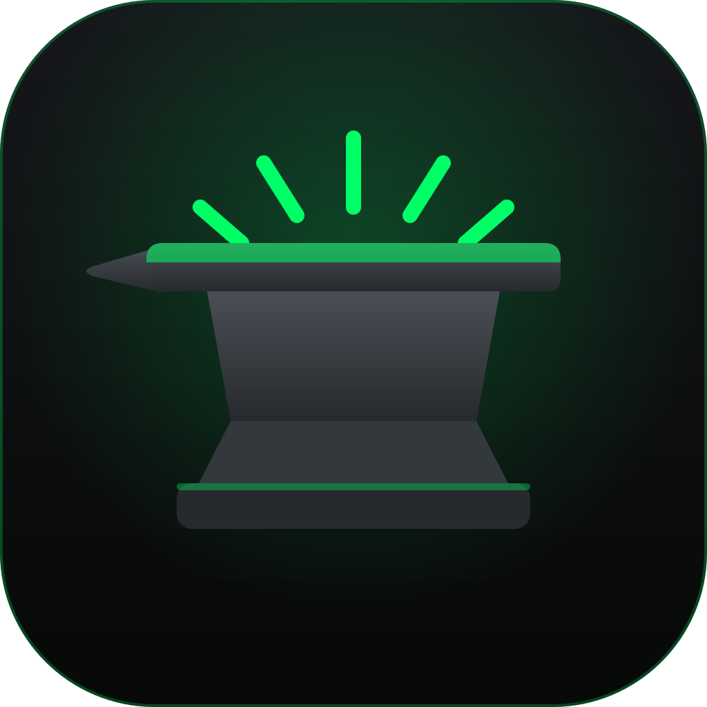

<p align="center">
  
</p>

<h1 align="center">Anvil</h1>

<p align="center">
  A native macOS agent harness for local and cloud models.<br>
  Swift 6 · SwiftUI · Xcode 27
</p>

---

## What Anvil does

- **Chat with local and cloud models** through providers for OpenAI-compatible endpoints (OpenAI, OpenRouter, NVIDIA NIM, LM Studio, Ollama), plus Anthropic and Google Gemini.
- **Artifacts:** code, Markdown, and HTML outputs with version history.
- **Quick open:** a Spotlight-backed file index for jumping to any file in the project.
- **Computer use:** a WebKit browser and Accessibility-based desktop control, with approval prompts before each action.
- **Git status** and a **PTY terminal** beside the chat.
- **MCP tools:** connect Model Context Protocol servers and approve each tool call.
- **Keychain** for API keys, and themes including a Matrix Techy mode.

## Status

| Milestone | State |
|-----------|-------|
| v1: app runs the embedded OpenCode CLI server | Shipping |
| v2.0: native Swift session engine (no CLI dependency) | In progress |
| Notarized DMG and auto-update | Planned |

## Build and run

Requirements: macOS with Xcode 27 (Swift 6 toolchain).

```bash
git clone https://github.com/noktirnal42/Anvil.git
cd Anvil
swift build
```

To run the app, open `Anvil/Package.swift` in Xcode 27 and select the **Anvil** scheme.

## Repository layout

| Path | Purpose |
|------|---------|
| `Anvil/Sources/AnvilApp` | SwiftUI app shell and views |
| `Anvil/Sources/AnvilKit` | Engine, providers, storage, and tooling |
| `Anvil/Tests` | Test target |
| `Anvil/script` | Build, embed, and DMG scripts |
| `branding/` | Icon and social-card master artwork (SVG) |
| `docs/` | Marketing site (GitHub Pages source) |
| `SPEC.md`, `SPEC-v2.0.md` | Product and engine specifications |

## License

Proprietary. All rights reserved. See [LICENSE](LICENSE).
